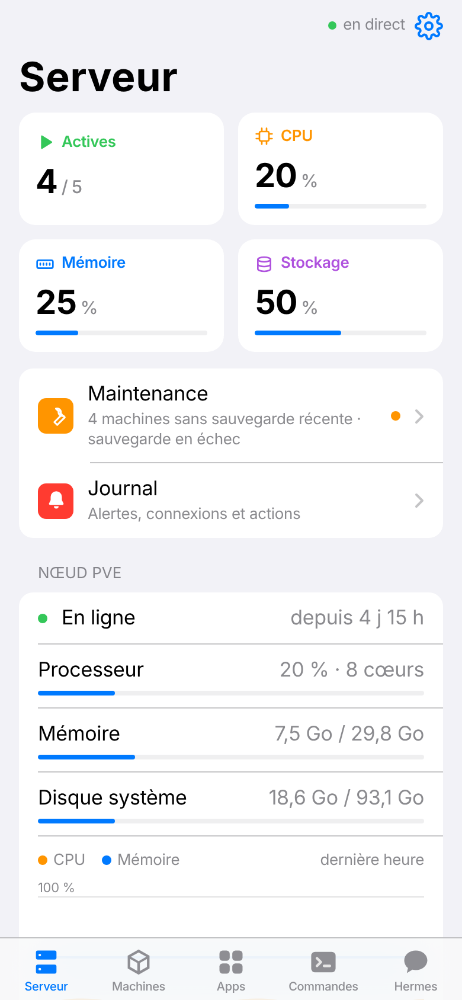
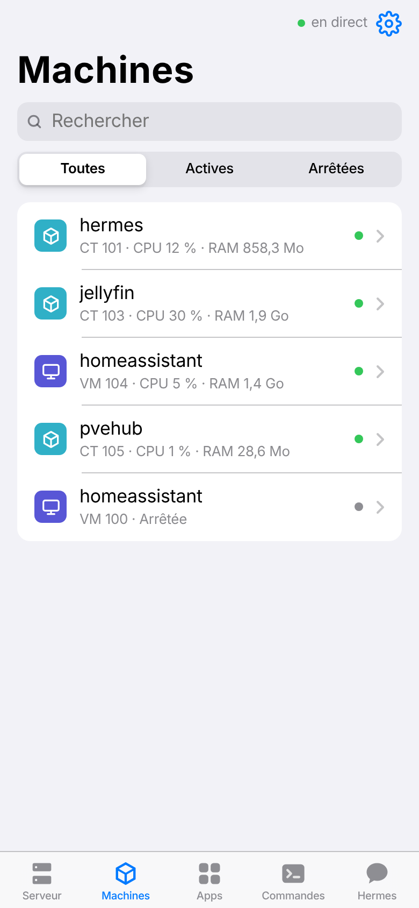
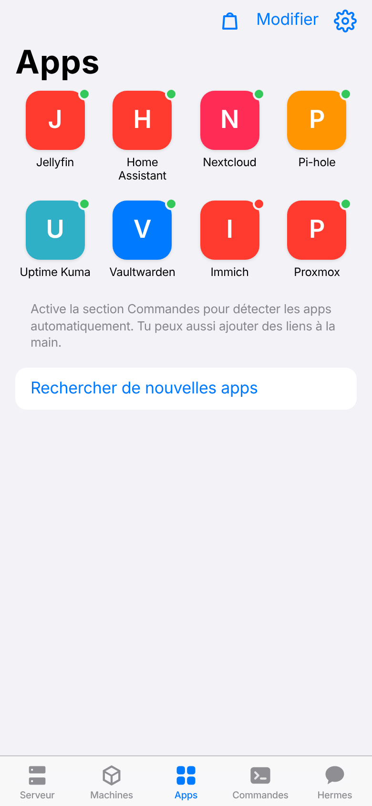
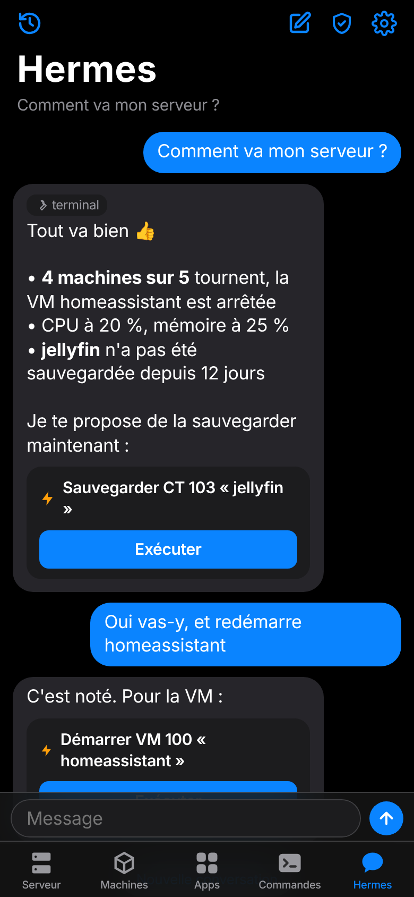
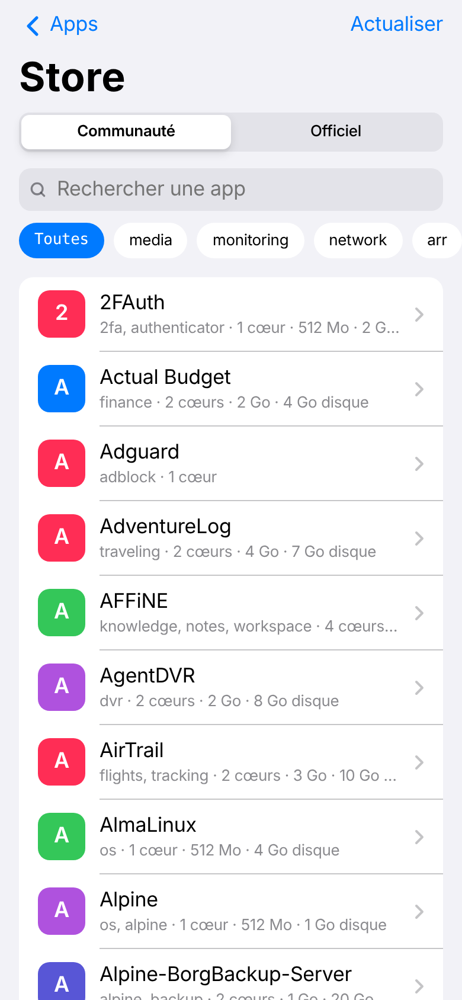
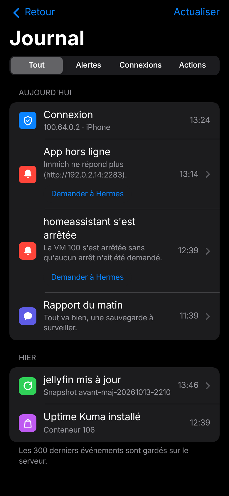
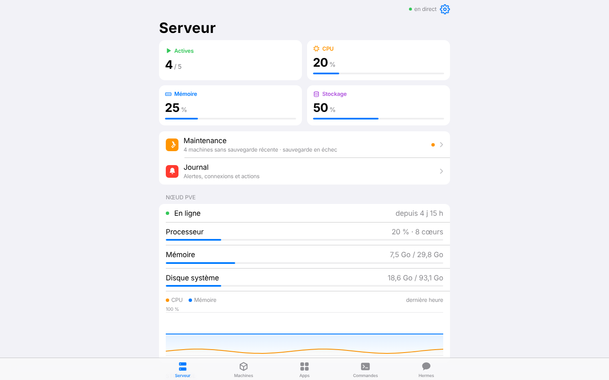

# PVE Hub

Petite app web pour piloter ton Proxmox depuis le téléphone, avec l'agent IA Hermes intégré.

<p align="center">
  
  
  
</p>
<p align="center">
  
  
  
</p>
<p align="center">
  
</p>
<p align="center"><sub>Serveur · Machines · Apps · Hermes (thème sombre) · Store · Journal · version ordinateur — données de démonstration</sub></p>

- **Serveur** : CPU, RAM, disque, stockage, graphiques sur 1 h, 24 h, 7 jours ou 30 jours
- **Machines** (VM et conteneurs) : démarrer, éteindre, redémarrer, forcer l'arrêt, snapshots, sauvegardes, démarrage automatique avec le serveur, cœurs, mémoire et
  agrandissement du disque
- **Apps** : tes services web (Home Assistant, Jellyfin…) en grille d'icônes, détectés automatiquement, avec un point
  vert s'ils répondent ; renommer, changer l'adresse, masquer, ajouter tes propres liens
- **Store** : installer de nouvelles apps — environ 600 scripts de la communauté (Home Assistant, Jellyfin, Pi-hole…)
  et les modèles officiels TurnKey de Proxmox — avec recherche, catégories et suivi de l'installation en direct
- **Commandes** : lancer une commande sur l'hôte, dans un conteneur ou une VM, et voir le résultat
- **Tâches planifiées** : la crontab de l'hôte et de chaque conteneur, en clair (« Tous les jours à 03:00 »)
- **Maintenance** : sauvegardes planifiées, ancienneté de la dernière sauvegarde de chaque machine, paquets à mettre
  à jour, mise à jour d'un conteneur ou d'une VM (avec l'agent QEMU) en un tap, avec un snapshot pris juste avant
- **Hermes** : il connaît l'état du serveur et peut proposer des actions que tu valides d'un tap ; il te demande
  l'autorisation avant ses commandes sensibles
- **Notifications** sur le téléphone : machine arrêtée toute seule, app qui ne répond plus, disque plein, disque en panne ou trop chaud, sauvegarde en échec ou en retard,
  résumé hebdomadaire des mises à jour
- **Rapport du matin** : chaque jour à l'heure choisie, Hermes résume l'état du serveur en une notification ;
  un tap l'ouvre dans la conversation pour lui répondre
- **Mise à jour de l'app** en un tap, thèmes clair/sombre, couleurs au choix

Ultra léger : un conteneur Alpine Linux (64 Mo de RAM alloués, environ 30 Mo utilisés, 1 Go de disque),
Python seul, aucune dépendance. L'app ne rafraîchit les données que lorsqu'elle est ouverte à l'écran.

## Sommaire

1. [Installation](#1-installation)
2. [Retrouver l'ID et l'IP du conteneur](#2-retrouver-lid-et-lip-du-conteneur)
3. [Brancher Hermes](#3-brancher-hermes)
4. [Mettre à jour](#4-mettre-à-jour)
5. [Accès depuis l'extérieur (Tailscale)](#5-accès-depuis-lextérieur-tailscale)
   - [Notifications sur le téléphone](#notifications-sur-le-téléphone)
   - [Store : installer de nouvelles apps](#store--installer-de-nouvelles-apps)
6. [Passer d'un ancien conteneur Debian à Alpine](#6-passer-dun-ancien-conteneur-debian-à-alpine)
7. [Modifier la configuration](#7-modifier-la-configuration)
8. [Dépannage](#8-dépannage)
9. [Désinstaller](#9-désinstaller)
10. [Sécurité](#10-sécurité)

Toutes les commandes se lancent dans le **Shell de l'hôte Proxmox** (interface web → ton nœud → **Shell**), sauf
mention contraire. Remplace `<ID>` par l'ID du conteneur PVE Hub.

## 1. Installation

1. Ouvre le Shell de ton nœud Proxmox et lance :
   ```bash
   bash <(curl -fsSL https://raw.githubusercontent.com/LBouzac/pvehub/main/pvehub-install.sh)
   ```
2. Réponds aux questions (Entrée = valeur proposée) :
   - **ID du conteneur** : le premier libre est proposé ;
   - **Stockage du disque** et **pont réseau** : les valeurs proposées conviennent presque toujours ;
   - **URL et clé de Hermes** : laisse vide si tu n'utilises pas Hermes (voir [section 3](#3-brancher-hermes)) ;
   - **Mot de passe de l'app** : un mot de passe aléatoire est proposé, note-le ;
   - **Section Commandes** : « o » pour pouvoir lancer des commandes, gérer les tâches planifiées, les mises à jour
     et mettre à jour l'app depuis le téléphone (voir [Sécurité](#10-sécurité)).
3. À la fin, le script affiche l'**adresse** (`http://IP:8080`) et le **mot de passe**.
4. Sur le téléphone : ouvre l'adresse dans Safari (ou Chrome), connecte-toi, puis **Partager → Sur l'écran d'accueil**.
   L'app s'ouvre ensuite en plein écran, comme une vraie app.

Ce que fait le script : il crée l'utilisateur Proxmox `pvehub@pve` avec un jeton API (rôles PVEVMAdmin,
PVEDatastoreUser, PVEAuditor), un conteneur Alpine non privilégié, et installe l'app comme service.

## 2. Retrouver l'ID et l'IP du conteneur

```bash
pct list                                    # l'ID est sur la ligne « pvehub »
pct exec <ID> -- ip -4 addr show eth0       # l'IP est après « inet »
```

Conseil : réserve cette IP dans ta box (bail DHCP fixe) pour que l'adresse de l'app ne change jamais.

## 3. Brancher Hermes

Hermes est facultatif : sans lui (adresse laissée vide à l'installation), son onglet et ses boutons n'apparaissent
pas. S'il est branché, tu peux aussi le couper dans **Réglages → Assistant**, pour tous tes appareils ; le rapport
du matin devient alors factuel et tes conversations sont gardées. Pour utiliser une autre IA (Claude, Mistral, un
modèle local…), choisis-la comme modèle dans la configuration de Hermes : PVE Hub n'a rien à changer.

1. Sur la machine où tourne Hermes, dans `~/.hermes/.env` :
   ```bash
   API_SERVER_ENABLED=true
   API_SERVER_HOST=0.0.0.0
   API_SERVER_KEY=une-cle-longue-et-secrete    # par exemple : openssl rand -hex 24
   ```
2. Redémarre `hermes gateway`.
3. Donne l'adresse (`http://IP-de-hermes:8642`) et la clé au script d'installation, ou plus tard dans la
   configuration de PVE Hub (voir [section 7](#7-modifier-la-configuration)).

La clé doit être **identique des deux côtés**, sinon le chat affiche « Hermes : 401 ». Pour la changer :

```bash
# 1. côté Hermes : nouvelle valeur de API_SERVER_KEY dans ~/.hermes/.env, puis redémarre hermes gateway
# 2. côté PVE Hub :
pct exec <ID> -- sed -i 's|^HERMES_KEY=.*|HERMES_KEY=la-nouvelle-cle|' /opt/pvehub/.env
pct exec <ID> -- rc-service pvehub restart
```

Hermes ne touche jamais Proxmox directement : il propose un bloc d'action, l'app te demande confirmation, puis
l'exécute avec son propre jeton. Le bouclier de l'onglet Hermes permet de l'autoriser d'avance pour les actions
sans risque (démarrer, éteindre, redémarrer, snapshot, sauvegarde). « Toujours » sur une demande d'autorisation est
retenu par Hermes lui-même : pour l'annuler, modifie sa configuration.

**Conversations** : dans l'onglet Hermes, l'icône en haut à gauche ouvre l'historique (recherche, reprendre une
conversation, **Modifier** pour en supprimer) ; l'icône crayon en haut à droite démarre une nouvelle conversation.
Chaque rapport du matin a sa propre conversation (☀️). **Demander à Hermes** (sur la fiche d'une machine, et sur les alertes ou
échecs du Journal) ouvre une nouvelle conversation avec la question prête et l'état de la machine ou le détail de
l'événement joints : relis, modifie si besoin, puis envoie. Les conversations sont gardées sur le serveur
(`data/chats.json`, les 100 plus récentes) : tu les retrouves sur tous tes appareils.

## 4. Mettre à jour

**Depuis l'app** (section Commandes activée) : quand une nouvelle version existe, un bandeau apparaît sur l'onglet
Serveur et un point rouge sur la roue dentée. L'app vérifie une fois par semaine ; pour vérifier tout de suite :
roue dentée → Mise à jour → **Vérifier maintenant**, puis **Installer**. L'app redémarre et la page se recharge seule.

**Depuis le Shell** :

```bash
bash <(curl -fsSL https://raw.githubusercontent.com/LBouzac/pvehub/main/pvehub-install.sh) update <ID>
```

Bon à savoir :
- GitHub garde l'ancienne version en cache environ 5 minutes après une publication. Pour être sûr d'avoir la
  dernière, remplace `main` par l'identifiant du dernier commit (visible sur la page du dépôt).
- La mise à jour demande si tu veux la section Commandes : « o » l'active ou la garde, « n » la retire.
- Lancée depuis l'onglet Commandes, elle garde le réglage actuel sans rien demander, et l'app affiche
  « Connexion coupée » quand elle redémarre : recharge la page.

## 5. Accès depuis l'extérieur (Tailscale)

Pour ouvrir l'app hors de chez toi (en 4G…), en HTTPS, sans ouvrir de port sur ta box. Il te faut un compte
Tailscale (gratuit) et l'app Tailscale sur ton téléphone, connectée au même compte.

### Option A — Tailscale est déjà installé sur l'hôte Proxmox (le plus simple)

1. Repère le nom de ton hôte sur Tailscale et ce qu'il publie déjà :
   ```bash
   tailscale status          # le nom complet est du type <hôte>.tailXXXX.ts.net
   tailscale serve status    # ce que l'hôte publie déjà en HTTPS
   ```
2. Publie l'app (remplace `<IP>` par l'IP du conteneur, voir [section 2](#2-retrouver-lid-et-lip-du-conteneur)) :
   - si rien n'est publié sur le port 443 :
     ```bash
     tailscale serve --bg http://<IP>:8080
     ```
     → l'app est sur `https://<hôte>.tailXXXX.ts.net`
   - si le port 443 est déjà pris (par exemple par l'interface Proxmox) :
     ```bash
     tailscale serve --bg --https=8443 http://<IP>:8080
     ```
     → l'app est sur `https://<hôte>.tailXXXX.ts.net:8443`
3. La première fois, Tailscale peut afficher un lien pour autoriser HTTPS sur ton réseau : ouvre-le et valide.
4. Sur le téléphone : ouvre la nouvelle adresse, connecte-toi, puis **Sur l'écran d'accueil**. Cette icône marche
   chez toi comme dehors ; tu peux supprimer l'ancienne.
5. L'app repère cette publication et affiche l'adresse dans **Réglages → Accès à distance**.

L'IP du conteneur doit rester fixe (réservation DHCP dans ta box), sinon le lien casse.

Pour couper l'accès : `tailscale serve --https=443 off` (ou `--https=8443 off`).

### Option B — Tailscale dans le conteneur PVE Hub

```bash
bash <(curl -fsSL https://raw.githubusercontent.com/LBouzac/pvehub/main/pvehub-install.sh) tailscale <ID>
```

Le script donne au conteneur l'accès à `/dev/net/tun` (le conteneur redémarre une fois), installe Tailscale, affiche
un **lien de connexion** à ouvrir sur ton téléphone ou ton ordinateur, puis active l'adresse
`https://pvehub.tailXXXX.ts.net`. La première fois, un second lien peut demander d'autoriser HTTPS. Le conteneur
apparaît comme une machine à part (« pvehub ») dans ton compte Tailscale.

- Pour couper l'accès : `pct exec <ID> -- tailscale logout`
- Une migration vers un nouveau conteneur ne reprend pas Tailscale : relance la commande après.

### Passer de l'option B à l'option A (nettoyage)

Si Tailscale a été installé dans le conteneur mais que tu utilises celui de l'hôte (Réglages affiche alors
« Tailscale installé mais pas connecté ») :

```bash
pct exec <ID> -- sh -c 'rc-service tailscale stop; rc-update del tailscale; apk del -q tailscale'
pct set <ID> --delete dev0      # retire /dev/net/tun ; effectif au prochain redémarrage du conteneur
```

Si `pct set` répond que `dev0` n'existe pas, ignore : le réglage n'avait pas été fait.

### Notifications sur le téléphone

Les notifications ont besoin de l'adresse HTTPS (Tailscale, ci-dessus). Sur iPhone : iOS 16.4 ou plus récent.

1. Mets PVE Hub à jour (roue dentée → Mise à jour) : la mise à jour installe le module de chiffrement nécessaire.
2. Sur le téléphone, ouvre l'adresse **HTTPS** et ajoute-la à l'écran d'accueil (Partager → Sur l'écran d'accueil).
3. Ouvre PVE Hub **depuis cette icône** (pas depuis Safari) : roue dentée → Notifications → **Activer sur cet
   appareil**, puis accepte la demande d'iOS.
4. Touche **Envoyer une notification de test** : elle doit arriver en quelques secondes.
5. Choisis tes alertes juste en dessous (elles valent pour tous tes appareils) :
   - **Machine arrêtée** : une VM ou un conteneur qui tournait s'arrête sans qu'aucun arrêt n'ait été lancé
     (panne, manque de mémoire…). Un arrêt, un redémarrage, une sauvegarde ou une migration lancés depuis l'app ou
     depuis Proxmox ne déclenchent rien ;
   - **App hors ligne** : une app de l'onglet Apps (Jellyfin, Home Assistant…) qui répondait ne répond plus,
     alors que sa machine tourne. Vérifié toutes les 5 minutes, alerte après deux échecs de suite ; son retour est
     noté dans le Journal ;
   - **Disque ou stockage plein** : au-delà du seuil choisi (80 à 95 %), rappel au plus une fois par jour ;
   - **Santé des disques** : état SMART des disques physiques lu par Proxmox, toutes les 6 heures. Alerte si un disque
     est en panne, si un SSD est usé à 90 % ou plus, ou s'il chauffe (55 °C pour un disque dur, 70 °C pour un SSD).
     Le détail (modèle, usure, température) est dans **Maintenance → Disques** ;
   - **Sauvegardes** : une sauvegarde en échec, et chaque matin les machines incluses dans une sauvegarde planifiée
     mais pas sauvegardées depuis 7 jours ;
   - **Résumé des mises à jour** : une fois par semaine, en matinée.

   - **Rapport du matin** : chaque jour à l'heure choisie (heure de ton téléphone), Hermes lit l'état du serveur
     (machines, sauvegardes de la nuit, disques, mises à jour, alertes des dernières 24 h) et t'envoie l'essentiel
     en une phrase. Toucher la notification ouvre le rapport complet dans la conversation : tu peux lui répondre
     directement (« que dois-je faire pour… »). Sans Hermes, ou s'il ne répond pas, tu reçois un rapport factuel.
     **Recevoir le rapport maintenant** permet d'essayer tout de suite.

Le serveur vérifie tout cela chaque minute, même quand l'app est fermée. Toucher une notification ouvre directement
la machine concernée ou l'écran Maintenance. Répète l'étape 3 sur chaque appareil qui doit recevoir les alertes.

### Journal

Onglet **Serveur** → **Journal** : l'historique de ce qui s'est passé, regroupé par jour, avec des filtres.
- **Alertes** : toutes les alertes envoyées (même celles que tu as balayées) et les rapports du matin ;
- **Connexions** : connexions réussies et mots de passe incorrects, avec l'adresse et le type d'appareil ;
- **Actions** : apps installées ou désinstallées par le Store, mises à jour des machines et de PVE Hub,
  appareils déconnectés, changement de mot de passe.

Toucher un événement ouvre la machine ou l'écran concerné. Les 300 derniers événements sont gardés
(`data/events.json`).

## Store : installer de nouvelles apps

Onglet **Apps** → icône de sac en haut à droite.

- **Communauté** : les [Proxmox VE Helper-Scripts](https://github.com/community-scripts/ProxmoxVE) (non officiels,
  mais la référence du homelab). L'app lit leur catalogue une fois par semaine (bouton Actualiser pour forcer).
  1. Choisis une app, vérifie le disque, le stockage des modèles et le réseau proposés, puis **Installer**.
  2. Le script s'exécute **en root sur l'hôte**, avec ses réglages par défaut (« Default Install ») : il crée un
     nouveau conteneur. Le journal défile en direct ; à la fin, l'adresse de l'app s'affiche.
  3. Tu peux masquer la fenêtre pendant l'installation : elle reste visible en haut du Store.
  - Pour choisir toi-même les réglages (taille, IP fixe…) : **Copier la commande**, colle-la dans le Shell de
    Proxmox et choisis « Advanced ».
  - Nécessite la section Commandes.
- **Officiel** : les appliances TurnKey Linux du catalogue de Proxmox (WordPress, Nextcloud, GitLab…), installées
  uniquement par l'API de Proxmox.
  1. **Installer** : Proxmox télécharge le modèle, crée le conteneur (2 cœurs, 1 Go, 8 Go) et le démarre.
  2. Note le **mot de passe root** affiché : il ne sera plus montré.
  3. Dans Proxmox, ouvre la **Console** du nouveau conteneur et connecte-toi en root : l'assistant TurnKey demande
     les mots de passe de l'application et termine la configuration.

Les nouvelles apps apparaissent ensuite dans l'onglet Apps, sous leur nom du Store. Si aucun port web n'est détecté,
l'adresse affichée à l'installation sert de lien.

**Désinstaller** : onglet Apps → **Modifier** → touche l'app → **Désinstaller l'app…**
- « Sauvegarder puis supprimer » : sauvegarde complète du conteneur, puis arrêt et suppression (disques compris).
  Si la sauvegarde échoue, rien n'est supprimé. Pour récupérer l'app plus tard, restaure cette sauvegarde depuis
  Proxmox (stockage → Sauvegardes).
- « Supprimer sans sauvegarde » : définitif.
- Seules les apps installées par le Store proposent ce bouton ; tes autres machines ne peuvent pas être supprimées
  d'ici.

## 6. Passer d'un ancien conteneur Debian à Alpine

Les installations d'avant octobre 2026 utilisaient Debian (128 Mo, 2 Go). Pour passer à Alpine, **depuis le Shell
de Proxmox** (pas depuis l'onglet Commandes, qui serait coupé en route) :

```bash
bash <(curl -fsSL https://raw.githubusercontent.com/LBouzac/pvehub/main/pvehub-install.sh) migrate <ID>
```

1. Le script copie la configuration (mot de passe, clé Hermes, clé SSH, réglages des Apps).
2. Il crée un nouveau conteneur Alpine avec la **même adresse MAC** : ta box lui redonne normalement la même IP,
   et ton raccourci sur le téléphone continue de marcher.
3. Il arrête l'ancien conteneur, installe l'app dans le nouveau et vérifie qu'elle répond.
4. En cas d'échec, il redémarre l'ancien conteneur tout seul.
5. À la fin, il propose de supprimer l'ancien (par défaut : non ; il reste arrêté et ne redémarre plus tout seul).
   Pour le supprimer plus tard : `pct destroy <ancien-ID>`.

Le nouveau conteneur a un **nouvel ID** : utilise-le pour les commandes suivantes (`pct list`).

## 7. Modifier la configuration

La configuration est dans `/opt/pvehub/.env`, dans le conteneur :

```bash
pct enter <ID>
vi /opt/pvehub/.env          # i pour écrire, Échap puis :wq pour enregistrer
rc-service pvehub restart
exit
```

| Réglage | Rôle |
|---|---|
| `APP_PASSWORD` | Mot de passe de l'app, tant qu'il n'a pas été changé dans Réglages → Sécurité |
| `HERMES_URL` / `HERMES_KEY` | Adresse et clé de l'API Hermes (vide = sans Hermes) |
| `PVE_URL` / `PVE_TOKEN` | Adresse de l'API Proxmox et jeton (créés par l'installeur) |
| `PVE_VERIFY_SSL` | `true` si ton Proxmox a un certificat valide |
| `PORT` | Port de l'app (8080 par défaut) |
| `EXEC_ENABLED` | `false` pour couper la section Commandes sans retirer la clé |
| `UPDATE_REPO` | Dépôt GitHub d'où viennent les mises à jour (pour un fork) |
| `APP_SECRET` | Clé des sessions ; la changer déconnecte tous les appareils |

## 8. Dépannage

Commandes utiles :

```bash
pct exec <ID> -- tail -n 50 /var/log/pvehub.log    # journal de l'app
pct exec <ID> -- rc-service pvehub restart         # redémarrer l'app
```

Anciens conteneurs Debian : `journalctl -u pvehub -n 50` et `systemctl restart pvehub` à la place.

| Symptôme | Solution |
|---|---|
| L'app ne s'ouvre plus | Le conteneur est-il allumé (`pct list`) ? Regarde le journal. L'IP a-t-elle changé ([section 2](#2-retrouver-lid-et-lip-du-conteneur)) ? |
| « Hermes : 401 » dans le chat | La clé diffère entre Hermes et PVE Hub ([section 3](#3-brancher-hermes)) |
| « Hermes injoignable » | `API_SERVER_HOST=0.0.0.0` dans `~/.hermes/.env` et `hermes gateway` relancé |
| « Load failed » ou « Connexion coupée » pendant une commande | La commande a redémarré l'app (mise à jour) : recharge la page |
| La mise à jour installe l'ancienne version | Cache GitHub de 5 min : attends, ou utilise l'identifiant du commit au lieu de `main` |
| « Erreur interne (…) » | Le message indique la cause ; envoie-le avec la fin du journal dans une issue GitHub |
| Section Commandes « Pas encore activé » | Relance `update <ID>` depuis le Shell et réponds « o » |
| Une app n'apparaît pas dans l'onglet Apps | La machine doit être allumée et le service écouter sur un port web. Pour une VM, l'agent QEMU doit être installé (`qemu-guest-agent`). Sinon, ajoute le lien à la main (Modifier → +) |
| « cron n'est pas installé » | Dans le conteneur : `apk add cronie` (Alpine) ou `apt install cron` (Debian) |
| « Snapshot impossible » pendant une mise à jour | Le stockage du conteneur ne gère pas les snapshots (il faut LVM-thin, ZFS ou Ceph) : l'app propose de continuer sans |
| Réglages affiche « Tailscale installé mais pas connecté » | Voir [le nettoyage](#passer-de-loption-b-à-loption-a-nettoyage) si tu utilises le Tailscale de l'hôte |
| Notifications « Indisponible ici » | Ouvre l'app en HTTPS (adresse Tailscale) et depuis son icône de l'écran d'accueil, pas depuis Safari (iOS 16.4+) |
| Notifications « Mise à jour nécessaire » | Mets PVE Hub à jour : le module `py3-cryptography` sera installé |
| Maintenance : « Agent QEMU absent » sur une VM | Dans la VM : `apt install qemu-guest-agent` puis `systemctl enable --now qemu-guest-agent` ; dans Proxmox, VM → Options → QEMU Guest Agent → Activé, puis redémarre la VM. Les VM Windows ne sont pas prises en charge |
| La notification de test n'arrive pas | Le conteneur doit pouvoir joindre Internet (`web.push.apple.com` sur iPhone). Regarde le journal (« Notification refusée… »). Vérifie aussi Réglages de l'iPhone → Notifications → PVE Hub |
| Le rapport du matin arrive à la mauvaise heure | Change l'heure une fois dans Réglages depuis le téléphone : il transmet son fuseau horaire. Mets aussi PVE Hub à jour (paquet `tzdata`) |
| Le rapport est « factuel » au lieu d'être rédigé par Hermes | Hermes n'a pas répondu à temps : regarde le journal (« Rapport : Hermes indisponible… ») et la section 3 |
| Plus de notifications après avoir supprimé l'icône | Normal : l'abonnement est lié à l'icône. Rajoute l'app à l'écran d'accueil et réactive |
| Store : « Permission check failed … SDN.Use » ou « … Datastore.AllocateTemplate » | Mets PVE Hub à jour : la mise à jour donne à `pvehub@pve` le droit réseau (rôle PVESDNUser) et le droit de télécharger des modèles (rôle dédié PVEHubTemplates, sur les stockages uniquement) |
| Store : « Catalogue injoignable » | Le conteneur doit pouvoir joindre `codeload.github.com`. Réessaie avec Actualiser |
| Store : l'installation d'un script communautaire échoue ou bloque | Le journal montre où. Relance-la depuis le Shell avec « Copier la commande » pour voir les questions éventuelles |
| Mot de passe oublié | Dans le Shell : `pct exec <ID> -- sh -c 'rm -f /opt/pvehub/data/auth.json && rc-service pvehub restart'`. Le mot de passe redevient celui de `APP_PASSWORD` ([section 7](#7-modifier-la-configuration)) |
| Le conteneur ne démarre pas à l'installation | `pct start <ID> --debug` et regarde les dernières lignes |

## 9. Désinstaller

```bash
pct stop <ID> && pct destroy <ID>                            # le conteneur et l'app
pveum user delete pvehub@pve                                 # l'utilisateur et son jeton API
sed -i --follow-symlinks '/ pvehub$/d' /root/.ssh/authorized_keys   # la clé SSH de la section Commandes
tailscale serve --https=8443 off                             # si tu avais publié l'app via l'hôte (ou 443)
```

`--follow-symlinks` est important : sur Proxmox, `authorized_keys` est un lien vers la configuration du cluster.

## 10. Sécurité

- **Section Commandes** : la clé SSH du conteneur donne un accès root à l'hôte. Quiconque a le mot de passe de l'app
  peut donc tout faire sur le serveur. Choisis un mot de passe solide, ou désactive la section.
- **Mise à jour depuis l'app** : elle exécute en root ce qui est publié sur le dépôt GitHub configuré. Active la
  double authentification sur ce compte GitHub.
- Notifications : le contenu est chiffré de bout en bout entre ton serveur et ton téléphone (standard Web Push) ;
  Apple ou Google ne font que transporter un message illisible.
- Accès protégé par mot de passe (session de 30 jours). Dans **Réglages → Sécurité** :
  - **Appareils connectés** : chaque appareil connecté, avec sa dernière activité ; touche-en un pour le
    déconnecter seul ;
  - **Tentatives de connexion** : ouvre le [Journal](#journal) filtré sur les connexions ;
  - **Changer le mot de passe** : il est enregistré haché dans `data/auth.json` et remplace `APP_PASSWORD` ;
    les autres appareils sont déconnectés ;
  - **Déconnecter les autres appareils** : utile si un téléphone est perdu.
- Un mot de passe incorrect envoie une notification (au plus une toutes les 10 minutes).
- Le cookie de session est réservé à HTTPS quand l'app est ouverte en HTTPS, et l'app refuse d'être affichée dans
  le cadre d'un autre site.
- Fait pour le réseau local. Depuis l'extérieur, passe par Tailscale ou un autre VPN, jamais par un port ouvert sur
  ta box.
- L'API de Hermes donne accès à son terminal : garde sa clé secrète et ne l'expose pas sur Internet.

## Développement

Sources dans `app/`. `python3 build.py` régénère `pvehub-install.sh` (un seul fichier) et `VERSION`.
Tests : `python3 app/test_server.py`.
Lancer en local : `PVE_URL=https://IP:8006 PVE_TOKEN='user@pve!id=secret' APP_PASSWORD=x python3 app/server.py`.

## Licence

MIT — voir [LICENSE](LICENSE).

Icône « réglages » adaptée de [Feather Icons](https://feathericons.com) (MIT, © Cole Bemis).

Développé avec l'aide de Claude (Anthropic).

PVE Hub est un projet indépendant, sans lien avec Proxmox Server Solutions GmbH ni avec Nous Research.
Proxmox est une marque déposée de Proxmox Server Solutions GmbH.
